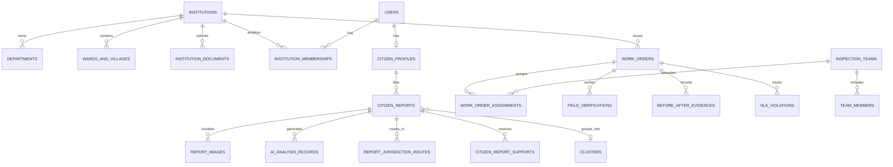

# InfraLens Database Schema Specification

**Database Engine**: PostgreSQL 16+ with PostGIS 3.4+ Spatial Extension  
**Architecture**: Multi-Tenant, Role-Based Access Control (RBAC), Row-Level Security (RLS)  
**Schema Version**: 2.0.0 (Production Civic Operations Edition)  

---

## 1. Schema Architecture & Principles

1. **Multi-Tenant Isolation**: Every institutional operational entity contains an `institution_id` foreign key referencing `institutions`. Tenant isolation is enforced via PostgreSQL Row-Level Security (RLS) policies.
2. **Citizen Privacy**: Citizen complaint residential locations are separated from internal municipal work orders. Public GIS queries utilize approximate spatial buffers (`ST_SnapToGrid` or masked centroids) rather than raw residential coordinates.
3. **Decoupled Workflows**:
   - `citizen_reports`: Complaints submitted by citizens, subject to duplicate clustering and community support.
   - `work_orders`: Official municipal execution units with assigned department, supervisor, inspection team, budget, and SLA lifecycle.
4. **Spatial Indexing**: All point locations and boundary polygons utilize PostGIS `GEOMETRY` with `GIST` indexing in WGS 84 (`EPSG:4326`) and spatial calculations via `ST_DWithin` and `ST_Contains`.
5. **Immutable Auditing**: Key status transitions (institutional verification, work order stage progression, resolution sign-offs) write append-only audit records.

---

## 2. Entity-Relationship Overview



---

## 3. PostGIS Extension & Custom Types DDL

```sql
-- Enable PostGIS & UUID extensions
CREATE EXTENSION IF NOT EXISTS "uuid-ossp";
CREATE EXTENSION IF NOT EXISTS "postgis";

-- 1. User Roles ENUM
CREATE TYPE user_role_enum AS ENUM (
    'CITIZEN',
    'INFRALENS_SUPER_ADMIN',
    'MUNICIPAL_ADMIN',
    'PANCHAYAT_ADMIN',
    'DIRECTOR_OF_OPERATIONS',
    'CHIEF_FIELD_INSPECTOR',
    'DEPARTMENT_SUPERVISOR',
    'FIELD_INSPECTOR'
);

-- 2. Institution Types ENUM
CREATE TYPE institution_type_enum AS ENUM (
    'municipal_corporation', -- Large ULB
    'municipality',          -- Medium ULB
    'municipal_board',       -- Small ULB / Town Council
    'gram_panchayat',        -- Rural Local Body (Village level)
    'panchayat_samiti',      -- Rural Local Body (Block level)
    'zilla_parishad',        -- Rural Local Body (District level)
    'state_highway_dept',    -- State PWD / Highway Authority
    'discom_utility'         -- Electricity Distribution Utility
);

-- 3. Institution Size Tier ENUM
CREATE TYPE institution_size_enum AS ENUM (
    'SMALL',
    'MEDIUM',
    'LARGE'
);

-- 4. Institution Verification Status ENUM
CREATE TYPE verification_status_enum AS ENUM (
    'DRAFT',
    'SUBMITTED',
    'DOCUMENT_REVIEW',
    'FIELD_VERIFIED',
    'APPROVED',
    'REJECTED',
    'SUSPENDED'
);

-- 5. Defect Severity Level ENUM
CREATE TYPE severity_level_enum AS ENUM (
    'LOW',
    'MEDIUM',
    'HIGH',
    'CRITICAL'
);

-- 6. Citizen Report Status ENUM
CREATE TYPE report_status_enum AS ENUM (
    'SUBMITTED',
    'AI_ANALYZED',
    'JURISDICTION_ASSIGNED',
    'COMMUNITY_VERIFIED',
    'WORK_ORDER_CREATED',
    'REPAIR_IN_PROGRESS',
    'RESOLVED',
    'REJECTED_INVALID',
    'DUPLICATE_MERGED'
);

-- 7. Work Order Lifecycle Status ENUM
CREATE TYPE work_order_status_enum AS ENUM (
    'CREATED',
    'INSPECTION_SCHEDULED',
    'FIELD_VERIFIED',
    'REPAIR_DISPATCHED',
    'CREW_ON_SITE',
    'REPAIR_COMPLETED',
    'EVIDENCE_SUBMITTED',
    'INSPECTION_APPROVED',
    'CLOSED_RESOLVED',
    'REJECTED_REOPENED'
);
```

---

## 4. The 24 Database Entities DDL

### 1. `institutions`
Represents local government authorities (ULBs and PRIs) registered on InfraLens.
```sql
CREATE TABLE institutions (
    id UUID PRIMARY KEY DEFAULT uuid_generate_v4(),
    name VARCHAR(255) NOT NULL,
    official_code VARCHAR(50) UNIQUE NOT NULL, -- e.g., 'ULB-DEL-NDMC', 'GP-WB-NAD-04'
    institution_type institution_type_enum NOT NULL,
    size_tier institution_size_enum NOT NULL DEFAULT 'SMALL',
    state VARCHAR(100) NOT NULL,
    district VARCHAR(100) NOT NULL,
    headquarters_address TEXT NOT NULL,
    official_email VARCHAR(255) NOT NULL,
    official_phone VARCHAR(20) NOT NULL,
    nodal_officer_name VARCHAR(255) NOT NULL,
    nodal_officer_designation VARCHAR(100) NOT NULL,
    boundary GEOMETRY(MULTIPOLYGON, 4326),
    centroid GEOMETRY(POINT, 4326),
    verification_status verification_status_enum NOT NULL DEFAULT 'DRAFT',
    verification_notes TEXT,
    subscription_tier VARCHAR(50) DEFAULT 'STANDARD', -- 'STARTER', 'STANDARD', 'ENTERPRISE'
    is_active BOOLEAN NOT NULL DEFAULT TRUE,
    created_at TIMESTAMPTZ NOT NULL DEFAULT NOW(),
    updated_at TIMESTAMPTZ NOT NULL DEFAULT NOW()
);
CREATE INDEX idx_institutions_boundary ON institutions USING GIST(boundary);
CREATE INDEX idx_institutions_centroid ON institutions USING GIST(centroid);
CREATE INDEX idx_institutions_status ON institutions(verification_status);
```

### 2. `institution_documents`
Verification documents uploaded by ULBs/Panchayats during onboarding.
```sql
CREATE TABLE institution_documents (
    id UUID PRIMARY KEY DEFAULT uuid_generate_v4(),
    institution_id UUID NOT NULL REFERENCES institutions(id) ON DELETE CASCADE,
    document_type VARCHAR(100) NOT NULL, -- 'GOVERNMENT_GAZETTE', 'DISTRICT_COLLECTOR_NOC', 'AUTHORISATION_LETTER', 'PAN_GST'
    document_url TEXT NOT NULL,
    file_size_bytes BIGINT NOT NULL,
    mime_type VARCHAR(50) NOT NULL,
    uploaded_by_email VARCHAR(255) NOT NULL,
    verification_status VARCHAR(50) NOT NULL DEFAULT 'PENDING', -- 'PENDING', 'ACCEPTED', 'REJECTED'
    reviewed_by_admin_id UUID,
    review_comments TEXT,
    uploaded_at TIMESTAMPTZ NOT NULL DEFAULT NOW(),
    reviewed_at TIMESTAMPTZ
);
CREATE INDEX idx_inst_docs_inst ON institution_documents(institution_id);
```

### 3. `institution_audit_trail`
Audit logs of institutional verification and size reclassification decisions.
```sql
CREATE TABLE institution_audit_trail (
    id UUID PRIMARY KEY DEFAULT uuid_generate_v4(),
    institution_id UUID NOT NULL REFERENCES institutions(id) ON DELETE CASCADE,
    action VARCHAR(100) NOT NULL, -- 'SIZE_EVALUATED', 'STATUS_CHANGE', 'DOCUMENT_REJECTED'
    previous_state JSONB,
    new_state JSONB,
    performed_by_id UUID,
    rationale TEXT NOT NULL,
    ip_address VARCHAR(45),
    created_at TIMESTAMPTZ NOT NULL DEFAULT NOW()
);
CREATE INDEX idx_inst_audit_inst ON institution_audit_trail(institution_id);
```

### 4. `departments`
Functional departments within a municipality or panchayat.
```sql
CREATE TABLE departments (
    id UUID PRIMARY KEY DEFAULT uuid_generate_v4(),
    institution_id UUID NOT NULL REFERENCES institutions(id) ON DELETE CASCADE,
    code VARCHAR(50) NOT NULL, -- 'ROADS_BRIDGES', 'WATER_SEWAGE', 'ELECTRICAL_LIGHTING', 'SOLID_WASTE'
    name VARCHAR(255) NOT NULL,
    description TEXT,
    sla_critical_hours INT NOT NULL DEFAULT 24,
    sla_high_hours INT NOT NULL DEFAULT 48,
    sla_medium_hours INT NOT NULL DEFAULT 120,
    sla_low_hours INT NOT NULL DEFAULT 240,
    is_active BOOLEAN NOT NULL DEFAULT TRUE,
    created_at TIMESTAMPTZ NOT NULL DEFAULT NOW(),
    UNIQUE(institution_id, code)
);
CREATE INDEX idx_departments_inst ON departments(institution_id);
```

### 5. `wards_and_villages`
Sub-jurisdictional geographic polygons for localized routing and inspector assignment.
```sql
CREATE TABLE wards_and_villages (
    id UUID PRIMARY KEY DEFAULT uuid_generate_v4(),
    institution_id UUID NOT NULL REFERENCES institutions(id) ON DELETE CASCADE,
    ward_number VARCHAR(50) NOT NULL,
    name VARCHAR(255) NOT NULL,
    zone VARCHAR(100),
    boundary GEOMETRY(POLYGON, 4326) NOT NULL,
    population_estimate INT DEFAULT 0,
    area_sq_km NUMERIC(10, 4),
    assigned_supervisor_id UUID,
    created_at TIMESTAMPTZ NOT NULL DEFAULT NOW(),
    UNIQUE(institution_id, ward_number)
);
CREATE INDEX idx_wards_boundary ON wards_and_villages USING GIST(boundary);
CREATE INDEX idx_wards_inst ON wards_and_villages(institution_id);
```

### 6. `users`
Global user identity table supporting both Citizens and Municipal Officials.
```sql
CREATE TABLE users (
    id UUID PRIMARY KEY DEFAULT uuid_generate_v4(),
    full_name VARCHAR(255) NOT NULL,
    email VARCHAR(255) UNIQUE NOT NULL,
    phone VARCHAR(20) UNIQUE,
    password_hash VARCHAR(255) NOT NULL,
    primary_role user_role_enum NOT NULL DEFAULT 'CITIZEN',
    is_email_verified BOOLEAN NOT NULL DEFAULT FALSE,
    is_phone_verified BOOLEAN NOT NULL DEFAULT FALSE,
    preferred_language VARCHAR(10) NOT NULL DEFAULT 'en', -- 'en', 'hi', 'bn', 'ta', 'te', 'mr', 'gu', 'kn', 'ml'
    is_active BOOLEAN NOT NULL DEFAULT TRUE,
    last_login_at TIMESTAMPTZ,
    created_at TIMESTAMPTZ NOT NULL DEFAULT NOW(),
    updated_at TIMESTAMPTZ NOT NULL DEFAULT NOW()
);
CREATE INDEX idx_users_email ON users(email);
CREATE INDEX idx_users_role ON users(primary_role);
```

### 7. `user_roles_permissions`
Fine-grained granular permissions attached to role definitions.
```sql
CREATE TABLE user_roles_permissions (
    id UUID PRIMARY KEY DEFAULT uuid_generate_v4(),
    role user_role_enum NOT NULL,
    permission VARCHAR(100) NOT NULL, -- e.g. 'report:create', 'report:view_nearby', 'workorder:approve', 'institution:verify'
    description TEXT,
    UNIQUE(role, permission)
);
```

### 8. `institution_memberships`
Links official users to institutions with their official designation.
```sql
CREATE TABLE institution_memberships (
    id UUID PRIMARY KEY DEFAULT uuid_generate_v4(),
    institution_id UUID NOT NULL REFERENCES institutions(id) ON DELETE CASCADE,
    user_id UUID NOT NULL REFERENCES users(id) ON DELETE CASCADE,
    department_id UUID REFERENCES departments(id) ON DELETE SET NULL,
    official_role user_role_enum NOT NULL,
    official_designation VARCHAR(150) NOT NULL, -- e.g., 'Chief Executive Officer', 'Assistant Engineer Roads'
    government_id_number VARCHAR(100),
    is_active BOOLEAN NOT NULL DEFAULT TRUE,
    joined_at TIMESTAMPTZ NOT NULL DEFAULT NOW(),
    UNIQUE(institution_id, user_id)
);
CREATE INDEX idx_inst_members_inst ON institution_memberships(institution_id);
CREATE INDEX idx_inst_members_user ON institution_memberships(user_id);
```

### 9. `citizen_profiles`
Citizen-specific metadata, residential locality, and public privacy preferences.
```sql
CREATE TABLE citizen_profiles (
    user_id UUID PRIMARY KEY REFERENCES users(id) ON DELETE CASCADE,
    state VARCHAR(100) NOT NULL,
    district VARCHAR(100) NOT NULL,
    city_or_village VARCHAR(100) NOT NULL,
    locality VARCHAR(255) NOT NULL,
    pincode VARCHAR(10) NOT NULL,
    home_coordinates GEOMETRY(POINT, 4326),
    public_privacy_radius_meters INT NOT NULL DEFAULT 3000, -- 500, 1000, 3000, 5000, 10000
    total_reports_submitted INT NOT NULL DEFAULT 0,
    reputation_score INT NOT NULL DEFAULT 100,
    created_at TIMESTAMPTZ NOT NULL DEFAULT NOW(),
    updated_at TIMESTAMPTZ NOT NULL DEFAULT NOW()
);
CREATE INDEX idx_citizen_home_coords ON citizen_profiles USING GIST(home_coordinates);
```

### 10. `citizen_reports`
The citizen complaint record. Distinct from municipal work orders.
```sql
CREATE TABLE citizen_reports (
    id UUID PRIMARY KEY DEFAULT uuid_generate_v4(),
    tracking_code VARCHAR(32) UNIQUE NOT NULL, -- e.g., 'INF-2026-000142'
    reporter_id UUID REFERENCES users(id) ON DELETE SET NULL, -- Nullable for anonymous submissions
    is_anonymous BOOLEAN NOT NULL DEFAULT FALSE,
    category VARCHAR(100) NOT NULL, -- 'asphalt_pothole', 'drainage_clog', 'water_main_leak', 'street_light_out'
    subtype VARCHAR(100),
    title VARCHAR(255) NOT NULL,
    description TEXT,
    landmark_notes TEXT,
    coordinates GEOMETRY(POINT, 4326) NOT NULL,
    formatted_address TEXT,
    pincode VARCHAR(10),
    severity severity_level_enum NOT NULL DEFAULT 'MEDIUM',
    hazard_score NUMERIC(5, 2) NOT NULL DEFAULT 0.0,
    status report_status_enum NOT NULL DEFAULT 'SUBMITTED',
    community_confirmations_count INT NOT NULL DEFAULT 0,
    is_duplicate BOOLEAN NOT NULL DEFAULT FALSE,
    master_report_id UUID REFERENCES citizen_reports(id),
    cluster_id UUID,
    created_at TIMESTAMPTZ NOT NULL DEFAULT NOW(),
    updated_at TIMESTAMPTZ NOT NULL DEFAULT NOW()
);
CREATE INDEX idx_reports_coords ON citizen_reports USING GIST(coordinates);
CREATE INDEX idx_reports_tracking ON citizen_reports(tracking_code);
CREATE INDEX idx_reports_status ON citizen_reports(status);
```

### 11. `report_images`
Citizen-uploaded evidence images with EXIF data and AI bounding boxes.
```sql
CREATE TABLE report_images (
    id UUID PRIMARY KEY DEFAULT uuid_generate_v4(),
    report_id UUID NOT NULL REFERENCES citizen_reports(id) ON DELETE CASCADE,
    storage_path TEXT NOT NULL,
    file_size_bytes BIGINT NOT NULL,
    mime_type VARCHAR(50) NOT NULL,
    width INT NOT NULL,
    height INT NOT NULL,
    bounding_boxes JSONB, -- Array of [{x, y, width, height, label, confidence}]
    defect_crop_path TEXT,
    exif_timestamp TIMESTAMPTZ,
    exif_gps GEOMETRY(POINT, 4326),
    uploaded_at TIMESTAMPTZ NOT NULL DEFAULT NOW()
);
CREATE INDEX idx_report_images_report ON report_images(report_id);
```

### 12. `ai_analysis_records`
Detailed computer vision and priority engine inference audit trail.
```sql
CREATE TABLE ai_analysis_records (
    id UUID PRIMARY KEY DEFAULT uuid_generate_v4(),
    report_id UUID NOT NULL REFERENCES citizen_reports(id) ON DELETE CASCADE,
    primary_defect_class VARCHAR(100) NOT NULL,
    confidence_score NUMERIC(5, 4) NOT NULL,
    severity_predicted severity_level_enum NOT NULL,
    pixel_area_ratio NUMERIC(5, 4) NOT NULL,
    calculated_priority_score NUMERIC(5, 2) NOT NULL, -- 0 to 100
    explainability_factors JSONB NOT NULL, -- breakdown of severity, density, traffic, POI
    inference_source VARCHAR(50) NOT NULL, -- 'CLIENT_EDGE_CANVAS', 'SERVER_YOLOV8_SEG'
    processing_time_ms INT NOT NULL,
    created_at TIMESTAMPTZ NOT NULL DEFAULT NOW()
);
CREATE INDEX idx_ai_records_report ON ai_analysis_records(report_id);
```

### 13. `report_jurisdiction_routes`
Administrative routing decisions and boundary resolution.
```sql
CREATE TABLE report_jurisdiction_routes (
    id UUID PRIMARY KEY DEFAULT uuid_generate_v4(),
    report_id UUID NOT NULL REFERENCES citizen_reports(id) ON DELETE CASCADE,
    state VARCHAR(100) NOT NULL,
    district VARCHAR(100) NOT NULL,
    institution_id UUID REFERENCES institutions(id) ON DELETE SET NULL,
    ward_id UUID REFERENCES wards_and_villages(id) ON DELETE SET NULL,
    department_id UUID REFERENCES departments(id) ON DELETE SET NULL,
    routing_method VARCHAR(50) NOT NULL, -- 'POSTGIS_SPATIAL_INTERSECTION', 'PINCODE_FALLBACK', 'MANUAL_DISPATCH'
    is_disputed BOOLEAN NOT NULL DEFAULT FALSE,
    dispute_reason TEXT,
    routed_at TIMESTAMPTZ NOT NULL DEFAULT NOW()
);
CREATE INDEX idx_report_routes_report ON report_jurisdiction_routes(report_id);
CREATE INDEX idx_report_routes_inst ON report_jurisdiction_routes(institution_id);
```

### 14. `citizen_report_supports`
Upvotes and corroborations from other citizens living within the area.
```sql
CREATE TABLE citizen_report_supports (
    id UUID PRIMARY KEY DEFAULT uuid_generate_v4(),
    report_id UUID NOT NULL REFERENCES citizen_reports(id) ON DELETE CASCADE,
    user_id UUID NOT NULL REFERENCES users(id) ON DELETE CASCADE,
    confirmation_type VARCHAR(50) NOT NULL DEFAULT 'STILL_PRESENT', -- 'STILL_PRESENT', 'ALSO_AFFECTED', 'REPAIRED'
    comment TEXT,
    supported_at TIMESTAMPTZ NOT NULL DEFAULT NOW(),
    UNIQUE(report_id, user_id)
);
CREATE INDEX idx_report_supports_report ON citizen_report_supports(report_id);
```

### 15. `clusters`
Spatial aggregations of geographically proximate defects.
```sql
CREATE TABLE clusters (
    id UUID PRIMARY KEY DEFAULT uuid_generate_v4(),
    institution_id UUID REFERENCES institutions(id) ON DELETE CASCADE,
    primary_category VARCHAR(100) NOT NULL,
    centroid GEOMETRY(POINT, 4326) NOT NULL,
    bounding_box GEOMETRY(POLYGON, 4326),
    report_count INT NOT NULL DEFAULT 1,
    average_priority NUMERIC(5, 2) NOT NULL DEFAULT 0.0,
    created_at TIMESTAMPTZ NOT NULL DEFAULT NOW(),
    updated_at TIMESTAMPTZ NOT NULL DEFAULT NOW()
);
CREATE INDEX idx_clusters_centroid ON clusters USING GIST(centroid);
```

### 16. `cluster_reports`
Associative table linking citizen reports to spatial clusters.
```sql
CREATE TABLE cluster_reports (
    cluster_id UUID NOT NULL REFERENCES clusters(id) ON DELETE CASCADE,
    report_id UUID NOT NULL REFERENCES citizen_reports(id) ON DELETE CASCADE,
    distance_meters NUMERIC(8, 2) NOT NULL,
    added_at TIMESTAMPTZ NOT NULL DEFAULT NOW(),
    PRIMARY KEY (cluster_id, report_id)
);
```

### 17. `work_orders`
Official internal municipal action unit.
```sql
CREATE TABLE work_orders (
    id UUID PRIMARY KEY DEFAULT uuid_generate_v4(),
    work_order_code VARCHAR(32) UNIQUE NOT NULL, -- e.g., 'WO-2026-00089'
    institution_id UUID NOT NULL REFERENCES institutions(id) ON DELETE CASCADE,
    department_id UUID NOT NULL REFERENCES departments(id) ON DELETE RESTRICT,
    ward_id UUID REFERENCES wards_and_villages(id) ON DELETE SET NULL,
    primary_report_id UUID REFERENCES citizen_reports(id) ON DELETE SET NULL,
    cluster_id UUID REFERENCES clusters(id) ON DELETE SET NULL,
    title VARCHAR(255) NOT NULL,
    description TEXT,
    priority_score NUMERIC(5, 2) NOT NULL,
    urgency_level severity_level_enum NOT NULL,
    status work_order_status_enum NOT NULL DEFAULT 'CREATED',
    estimated_cost_inr NUMERIC(12, 2),
    actual_cost_inr NUMERIC(12, 2),
    sla_deadline TIMESTAMPTZ NOT NULL,
    created_by_user_id UUID NOT NULL REFERENCES users(id),
    assigned_supervisor_id UUID REFERENCES users(id),
    created_at TIMESTAMPTZ NOT NULL DEFAULT NOW(),
    updated_at TIMESTAMPTZ NOT NULL DEFAULT NOW(),
    resolved_at TIMESTAMPTZ
);
CREATE INDEX idx_work_orders_inst ON work_orders(institution_id);
CREATE INDEX idx_work_orders_dept ON work_orders(department_id);
CREATE INDEX idx_work_orders_status ON work_orders(status);
```

### 18. `inspection_teams`
Field inspection squads configured by Chief Field Inspectors.
```sql
CREATE TABLE inspection_teams (
    id UUID PRIMARY KEY DEFAULT uuid_generate_v4(),
    institution_id UUID NOT NULL REFERENCES institutions(id) ON DELETE CASCADE,
    team_name VARCHAR(100) NOT NULL,
    chief_inspector_id UUID NOT NULL REFERENCES users(id),
    vehicle_registration VARCHAR(50),
    is_active BOOLEAN NOT NULL DEFAULT TRUE,
    created_at TIMESTAMPTZ NOT NULL DEFAULT NOW()
);
CREATE INDEX idx_insp_teams_inst ON inspection_teams(institution_id);
```

### 19. `team_members`
Field inspectors assigned to inspection teams.
```sql
CREATE TABLE team_members (
    team_id UUID NOT NULL REFERENCES inspection_teams(id) ON DELETE CASCADE,
    user_id UUID NOT NULL REFERENCES users(id) ON DELETE CASCADE,
    role_in_team VARCHAR(50) NOT NULL DEFAULT 'INSPECTOR', -- 'LEAD', 'INSPECTOR', 'DRIVER'
    assigned_at TIMESTAMPTZ NOT NULL DEFAULT NOW(),
    PRIMARY KEY (team_id, user_id)
);
```

### 20. `work_order_assignments`
Assignment of work orders to inspection teams or maintenance contractors.
```sql
CREATE TABLE work_order_assignments (
    id UUID PRIMARY KEY DEFAULT uuid_generate_v4(),
    work_order_id UUID NOT NULL REFERENCES work_orders(id) ON DELETE CASCADE,
    assigned_team_id UUID REFERENCES inspection_teams(id),
    contractor_name VARCHAR(255),
    assigned_by_id UUID NOT NULL REFERENCES users(id),
    assignment_notes TEXT,
    assigned_at TIMESTAMPTZ NOT NULL DEFAULT NOW()
);
CREATE INDEX idx_wo_assign_order ON work_order_assignments(work_order_id);
```

### 21. `field_verifications`
On-site ground verification records conducted by Field Inspectors.
```sql
CREATE TABLE field_verifications (
    id UUID PRIMARY KEY DEFAULT uuid_generate_v4(),
    work_order_id UUID NOT NULL REFERENCES work_orders(id) ON DELETE CASCADE,
    inspector_id UUID NOT NULL REFERENCES users(id),
    check_in_coordinates GEOMETRY(POINT, 4326) NOT NULL,
    gps_accuracy_meters NUMERIC(6, 2),
    is_defect_confirmed BOOLEAN NOT NULL,
    measured_dimensions JSONB, -- { length_m, width_m, depth_cm }
    field_notes TEXT,
    verified_at TIMESTAMPTZ NOT NULL DEFAULT NOW()
);
CREATE INDEX idx_verifications_coords ON field_verifications USING GIST(check_in_coordinates);
CREATE INDEX idx_verifications_wo ON field_verifications(work_order_id);
```

### 22. `before_after_evidences`
Paired photographic audit records proving resolution before sign-off.
```sql
CREATE TABLE before_after_evidences (
    id UUID PRIMARY KEY DEFAULT uuid_generate_v4(),
    work_order_id UUID NOT NULL REFERENCES work_orders(id) ON DELETE CASCADE,
    before_image_url TEXT NOT NULL,
    after_image_url TEXT NOT NULL,
    after_image_coordinates GEOMETRY(POINT, 4326),
    resolution_summary TEXT NOT NULL,
    materials_used TEXT,
    signed_off_by_chief_inspector_id UUID REFERENCES users(id),
    sign_off_notes TEXT,
    submitted_at TIMESTAMPTZ NOT NULL DEFAULT NOW(),
    signed_off_at TIMESTAMPTZ
);
CREATE INDEX idx_evidences_wo ON before_after_evidences(work_order_id);
```

### 23. `sla_violations`
Records tracking SLA escalation thresholds and breaches.
```sql
CREATE TABLE sla_violations (
    id UUID PRIMARY KEY DEFAULT uuid_generate_v4(),
    work_order_id UUID NOT NULL REFERENCES work_orders(id) ON DELETE CASCADE,
    institution_id UUID NOT NULL REFERENCES institutions(id) ON DELETE CASCADE,
    department_id UUID NOT NULL REFERENCES departments(id) ON DELETE CASCADE,
    violation_level VARCHAR(50) NOT NULL, -- 'WARNING_80_PERCENT', 'BREACHED_100_PERCENT', 'CRITICAL_ESCALATION'
    time_elapsed_hours NUMERIC(8, 2) NOT NULL,
    notified_supervisor_id UUID REFERENCES users(id),
    occurred_at TIMESTAMPTZ NOT NULL DEFAULT NOW()
);
CREATE INDEX idx_sla_inst ON sla_violations(institution_id);
```

### 24. `notifications_and_audit`
Append-only platform event log and outbound communication queue.
```sql
CREATE TABLE notifications_and_audit (
    id UUID PRIMARY KEY DEFAULT uuid_generate_v4(),
    institution_id UUID REFERENCES institutions(id) ON DELETE CASCADE,
    recipient_user_id UUID REFERENCES users(id) ON DELETE CASCADE,
    channel VARCHAR(50) NOT NULL, -- 'IN_APP', 'SMS', 'EMAIL', 'WHATSAPP'
    notification_type VARCHAR(100) NOT NULL, -- 'REPORT_SUBMITTED', 'WORK_ORDER_ASSIGNED', 'REPAIR_RESOLVED'
    title VARCHAR(255) NOT NULL,
    body TEXT NOT NULL,
    payload JSONB,
    is_read BOOLEAN NOT NULL DEFAULT FALSE,
    delivered_at TIMESTAMPTZ,
    created_at TIMESTAMPTZ NOT NULL DEFAULT NOW()
);
CREATE INDEX idx_notif_user ON notifications_and_audit(recipient_user_id);
CREATE INDEX idx_notif_created ON notifications_and_audit(created_at);
```

---

## 5. Row-Level Security (RLS) Multi-Tenant Policies

```sql
-- Enable RLS on operational tables
ALTER TABLE work_orders ENABLE ROW LEVEL SECURITY;
ALTER TABLE departments ENABLE ROW LEVEL SECURITY;
ALTER TABLE wards_and_villages ENABLE ROW LEVEL SECURITY;
ALTER TABLE inspection_teams ENABLE ROW LEVEL SECURITY;

-- 1. Super Admin Full Access Policy
CREATE POLICY super_admin_all_work_orders ON work_orders
    FOR ALL
    TO authenticated_users
    USING (
        EXISTS (
            SELECT 1 FROM users
            WHERE users.id = auth.uid()
            AND users.primary_role = 'INFRALENS_SUPER_ADMIN'
        )
    );

-- 2. Tenant Scoped Work Order Access Policy
CREATE POLICY tenant_isolation_work_orders ON work_orders
    FOR ALL
    TO authenticated_users
    USING (
        institution_id IN (
            SELECT institution_id FROM institution_memberships
            WHERE institution_memberships.user_id = auth.uid()
            AND institution_memberships.is_active = TRUE
        )
    );

-- 3. Public / Citizen Masked Geospatial Queries
-- Exposes centroid & approximate bounding boxes without leaking private home coordinates
CREATE OR REPLACE VIEW public_safe_citizen_reports AS
    SELECT 
        id,
        tracking_code,
        category,
        subtype,
        severity,
        hazard_score,
        status,
        community_confirmations_count,
        -- Snap to 100m grid for public privacy masking
        ST_SnapToGrid(coordinates, 0.001) AS approximate_coordinates,
        created_at
    FROM citizen_reports
    WHERE status != 'REJECTED_INVALID';
```
