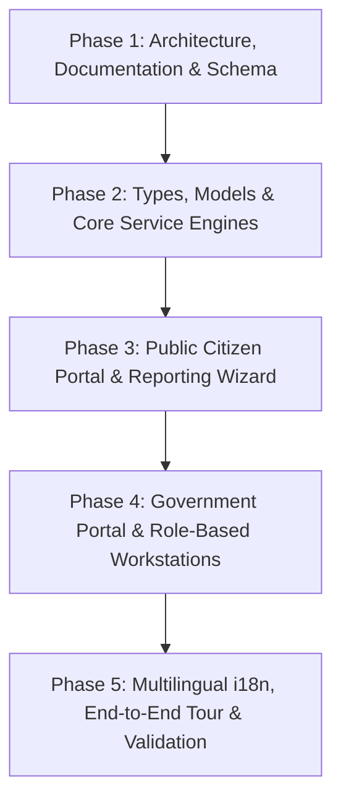

# InfraLens Implementation Roadmap

**Project**: InfraLens — AI-Powered Civic Infrastructure Intelligence & Municipal Operations Platform  
**Target Architecture**: Multi-Tenant, Dual-Portal (Citizen & Government), PostGIS Spatial Intelligence, RBAC  
**Status**: Active Execution  

---

## 1. Executive Summary & Goals

This roadmap outlines the systematic phased completion of the InfraLens platform. It transitions InfraLens from a single-tenant front-end prototype into a scalable, production-grade civic operations operating system serving Citizens, Urban Local Bodies (Municipal Corporations, Municipalities), Rural Local Bodies (Gram Panchayats), and Field Engineering Teams.

### Core Objectives:
1. **Preserve Validated AI & GIS Pipelines**: Zero regressions to the 46-scenario CV evaluation suite, client-side/FastAPI defect analysis, and Leaflet + MapTiler vector basemaps.
2. **True Decoupling of Concerns**: Complete separation between citizen damage reports (complaints with public tracking & community support) and internal municipal work orders (official institutional execution units with budget, crew assignment, and before/after evidence).
3. **Institutional Multi-Tenancy & Onboarding**: Self-service institutional registration for ULBs and Panchayats with document verification, institutional size tiering (`SMALL`, `MEDIUM`, `LARGE`), and departmental routing.
4. **Hierarchical RBAC**: Dedicated user experiences for 8 distinct roles: `CITIZEN`, `SUPER_ADMIN`, `MUNICIPAL_ADMIN`, `PANCHAYAT_ADMIN`, `DIRECTOR_OF_OPERATIONS`, `CHIEF_FIELD_INSPECTOR`, `DEPARTMENT_SUPERVISOR`, and `FIELD_INSPECTOR`.
5. **Geospatial Intelligence & Citizen Privacy**: Configurable privacy radius (500m to 10km) for citizen nearby discovery, PostGIS spatial queries, and automated duplicate/cluster grouping.
6. **Pan-Indian Accessibility**: Native multilingual interface supporting 9 major Indian languages (English, Hindi, Bengali, Tamil, Telugu, Marathi, Gujarati, Kannada, Malayalam).

---

## 2. Phase-by-Phase Execution Plan

---

### Phase 1: Architecture, Documentation & Database Schema Design
* **Objectives**: Audit the entire codebase, document gap analyses, and establish a production-grade relational + PostGIS database schema.
* **Deliverables**:
  - `docs/ARCHITECTURE_AUDIT.md`: Complete audit of all 10 areas distinguishing implemented, partial, mock, and missing modules.
  - `docs/IMPLEMENTATION_ROADMAP.md`: Detailed milestones, phases, acceptance criteria, and rollback strategies.
  - `docs/DATABASE_SCHEMA.md`: Full PostgreSQL 16 + PostGIS DDL covering 24 entities, spatial indexes (`GIST`), audit triggers, foreign keys, and Row-Level Security (RLS) tenant isolation policies.
* **Acceptance Criteria**:
  - All existing unit tests (`npm test`) and evaluation suites (`npm run eval`) pass with 100% accuracy.
  - Architecture documents approved and aligned with civic workflow requirements.

---

### Phase 2: Types, Domain Models & Core Service Engines
* **Objectives**: Create robust TypeScript interfaces and core domain logic engines for institutional classification, authority routing, and work order lifecycle.
* **Deliverables**:
  - `src/types/auth.ts`: 8 user roles, permission sets, login/registration data contracts.
  - `src/types/institution.ts`: ULBs (`municipal_corporation`, `municipality`, `municipal_board`), Rural PRIs (`gram_panchayat`, `panchayat_samiti`, `zilla_parishad`), sizes (`SMALL`, `MEDIUM`, `LARGE`), verification statuses (`DRAFT`, `SUBMITTED`, `DOCUMENT_REVIEW`, `VERIFIED`, `REJECTED`, `SUSPENDED`).
  - `src/types/citizen.ts`: `CitizenReport`, citizen profile, privacy radius, community support confirmations.
  - `src/types/workOrder.ts`: `WorkOrder`, milestones, inspection assignments, before/after photographic proof, SLA metrics.
  - `src/services/institutionClassificationEngine.ts`: Algorithmic size tiering with ward count, population, and inspector capacity with audit trail and administrative override.
  - `src/services/institutionVerificationService.ts`: Document review workflow (Government Gazettes, Authorisation letters, Tax IDs) with state transitions.
  - `src/services/authorityResolver.ts`: Hierarchical administrative routing (State -> District -> ULB/PRI -> Ward/Village -> Department), handling state highways (NHAI/PWD) and electricity distribution (Discoms), setting `AUTHORITY_REVIEW_REQUIRED` for edge disputes.
  - `src/services/workOrderService.ts`: Decoupled work order lifecycle management, crew assignment, and before/after verification.
  - `server/index.ts`: Enhanced REST API routes for `/api/v1/institutions`, `/api/v1/reports`, `/api/v1/work-orders`, and `/api/v1/spatial/nearby`.
* **Acceptance Criteria**:
  - Classification engine correctly categorizes ULBs and Panchayats into `SMALL`, `MEDIUM`, and `LARGE`.
  - Authority resolver routes damage reports accurately based on geographic coordinates and category, returning `AUTHORITY_REVIEW_REQUIRED` for borderline coordinates.
  - Backend compiles and tests run without regressions.

---

### Phase 3: Public Citizen Portal & 10-Step Damage Reporting Wizard
* **Objectives**: Deliver an intuitive, citizen-centric portal with mobile responsiveness, privacy controls, and a guided 10-step submission wizard.
* **Deliverables**:
  - `src/components/citizen/CitizenPortalView.tsx`: Main citizen portal hub.
  - **Citizen Report Wizard (10 Steps)**:
    1. Incident Photo Capture / Upload.
    2. Computer Vision Auto-Analysis (Real-time defect classification, confidence, bounding boxes).
    3. GPS Coordinate Pinning & Address Reverse Geocoding.
    4. Infrastructure Category & Subtype Confirmation.
    5. Severity & Public Safety Hazard Assessment.
    6. Citizen Description & Landmark Details.
    7. Automated Jurisdiction & ULB/Panchayat Identification.
    8. Duplicate Detection & Community Corroboration.
    9. Reporter Contact / Anonymous Option & Privacy Masking.
    10. Submission, Tracking Token Generation (`INF-2026-XXXXXX`), and Receipt.
  - **Nearby Issues Discovery**: Radius slider (500m, 1km, 3km, 5km, 10km) with privacy-protected jitter, "Confirm Still Present" upvote button, and "I am also affected" duplicate suppression.
  - **Citizen Tracking Hub**: Search and track status changes (Reported -> Verified -> Work Order Issued -> Repaired -> Closed).
* **Acceptance Criteria**:
  - Citizens can submit reports with GPS coordinates and images smoothly.
  - Exact residential coordinates of citizen reports are never exposed publicly; nearby queries display privacy-masked pins.
  - Duplicate complaints link to existing cluster without flooding field teams.

---

### Phase 4: Government Operations Portal & Role-Based Workstations
* **Objectives**: Build specialized operations dashboards tailored to each official role in the civic hierarchy.
* **Deliverables**:
  - `src/components/institution/InstitutionalRegistrationModal.tsx`: Complete registration flow for ULBs and Panchayats with document upload and size evaluation.
  - `src/components/views/ChiefInspectorDashboardView.tsx`:
    - Inspection team roster and dispatch schedule.
    - Pending field verifications queue.
    - Photographic evidence approval station.
  - `src/components/views/DepartmentSupervisorDashboardView.tsx`:
    - Departmental work order kanban (Backlog, Assigned, In Progress, Review, Completed).
    - Crew and contractor assignment.
    - Material and budget tracking.
  - `src/components/views/FieldInspectorMobileView.tsx`:
    - Field-optimized mobile card view.
    - Turn-by-turn navigation link to incident GPS.
    - On-site photo capture for Before/After verification audit.
  - `src/components/views/SuperAdminDashboardView.tsx`:
    - Cross-tenant institutional verification approvals/rejections.
    - Platform-wide telemetry (uptime, reports resolved, average SLA).
    - System health and tenant tier management.
  - Upgraded Header (`src/components/navigation/Header.tsx`):
    - Dynamic verified official identity (no hardcoded operators).
    - Institution name, jurisdiction badge, and role switcher for demo and testing.
* **Acceptance Criteria**:
  - Switching roles updates the interface and available actions immediately.
  - Work order creation transitions complaints through the official lifecycle.
  - Super Admin can approve pending institutional registrations.

---

### Phase 5: Multilingual i18n, Interactive Demo Tour & System Verification
* **Objectives**: Implement regional language localization, update the guided demo tour across all 12 operational stages, and verify end-to-end reliability.
* **Deliverables**:
  - `src/i18n/translations.ts`: Translation dictionary for English, Hindi (हिंदी), Bengali (বাংলা), Tamil (தமிழ்), Telugu (తెలుగు), Marathi (मराठी), Gujarati (ગુજરાતી), Kannada (ಕನ್ನಡ), Malayalam (മലയാളം).
  - Language selector component integrated into navigation.
  - `src/components/demo/InteractiveDemoTour.tsx`: Upgraded 12-stage guided simulation demonstrating:
    1. Citizen discovers pothole and snaps photo.
    2. AI vision detects defect and estimates severity.
    3. Authority engine resolves to Municipal Corporation / Ward.
    4. Director of Operations views incident on Command Center GIS.
    5. Chief Field Inspector dispatches inspection order.
    6. Field Inspector conducts mobile GPS verification.
    7. Department Supervisor creates Work Order and assigns road crew.
    8. Crew uploads repair photo for Before/After audit.
    9. Chief Inspector approves resolution.
    10. Citizen receives SMS/Email notification.
    11. Public dashboard marks issue green (Resolved).
    12. City Health Index updates positively.
  - Demo Seed Dataset (`src/data/demoSeed.ts`): Pre-populated institutions (1 Municipal Corporation, 1 Municipality, 1 Gram Panchayat), staff, and realistic sample reports.
* **Acceptance Criteria**:
  - Language toggle immediately switches UI labels across citizen and government portals.
  - Guided demo runs through all 12 stages without errors.
  - All test suites (`npm test`, `npm run eval`, `npm run build`, `npm run lint`) pass cleanly.

---

## 3. Milestones & Verification Timeline

| Milestone | Target Scope | Key Verification Gate | Status |
| :--- | :--- | :--- | :--- |
| **M1: Baseline & MapTiler** | MapTiler key, audit, fallback architecture | `npm test` (31/31), `npm run eval` (46/46), Map tiles render | **COMPLETE** |
| **M2: Docs & PostGIS DDL** | `ROADMAP.md`, `DATABASE_SCHEMA.md` | Architecture review & schema validation | **IN PROGRESS** |
| **M3: Types & Engines** | Auth, Institution, WorkOrder, Resolver, Classification | TypeScript compilation, engine unit tests | **QUEUED** |
| **M4: Citizen Portal** | 10-Step Wizard, Nearby Issues (500m-10km), Track My Issue | End-to-end report creation & privacy mask test | **QUEUED** |
| **M5: Government Workstations** | Chief Inspector, Dept Supervisor, Field Inspector, Super Admin | Role transitions, Work order lifecycle test | **QUEUED** |
| **M6: i18n & Tour** | 9 Indian languages, 12-Stage Demo Tour, Final Evaluation | Full build clean, zero lint errors, eval pass | **QUEUED** |

---

## 4. Risk Mitigation & Technical Guardrails

1. **AI Regression Risk**:
   - *Mitigation*: Do not touch or modify files in `src/services/cv/`. Run `npm run eval` after every change to verify that 46/46 scenarios retain 100% precision.
2. **Map Origin / Quota Errors**:
   - *Mitigation*: Automated fallback to CartoDB Dark Matter ensures the GIS map is always functional, even when running locally without MapTiler domain whitelist.
3. **Data Pollution & Multi-Tenancy Leaks**:
   - *Mitigation*: PostGIS schema enforces `institution_id` on all operational records; frontend contexts scope queries to the currently authenticated institution.
4. **Performance & Memory Overhead**:
   - *Mitigation*: Lazy-load heavy views, clean up Leaflet instances upon component unmount, and avoid unnecessary re-renders in high-frequency GIS feeds.
